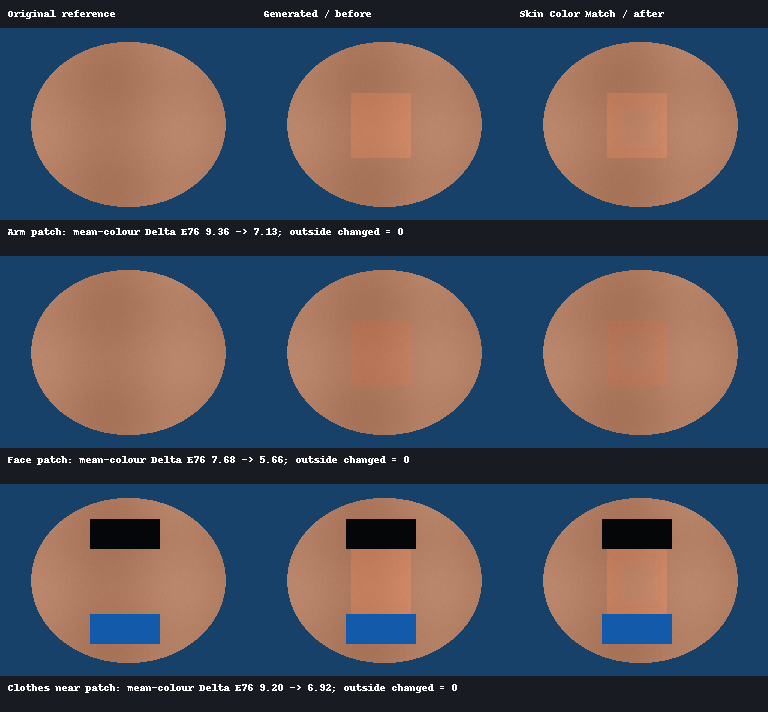

# Forge Skin Color Match

CPU-only, mask-contained skin colour matching for **Stable Diffusion WebUI Forge** inpainting.
No additional AI models. Independent extension; no Forge source changes.

Inpaintした肌だけにLAB色補正を適用し、周囲の元画像の肌色へ近づける拡張。
Auto／Manual参照、明度の独立調整、内向きフェザーに対応する。

**状態：初期実装。単体テスト・Forge実ソースによる座標検証・Gradio 4.40のUI構築を検証。
Forgeを起動したSDXL生成と、実写・イラストでの品質評価は未実施。**

## インストール

Forgeの `Extensions → Install from URL` に次のURLを入力し、インストール後にForgeを再起動する。

```text
https://github.com/K7LY/forge-skin-color-match
```

手動の場合はForgeのルートディレクトリから実行する。

```sh
git clone https://github.com/K7LY/forge-skin-color-match extensions/forge-skin-color-match
```

```text
extensions/forge-skin-color-match/
├── scripts/skin_color_match.py
├── skinmatch_core.py
├── tests/
├── tools/
├── docs/
├── LICENSE
└── README.md
```

実行時はForge同梱のPython・Gradio・NumPy・OpenCV・Pillowを使う。追加モデル、GPU処理、
外部API通信、依存パッケージの自動インストールは行わない。
`requirements-test.txt` は独立した開発環境専用。Forgeのvenvにはインストールしないこと。

## 使い方

1. `img2img → Inpaint` で元画像と編集マスクを設定する。
2. `Skin Color Match` パネルを開き、`Enable Skin Color Match` をONにする。
3. `Reference Mode: Auto` のまま生成する。編集範囲の外側に近接する肌から色を取得する。
4. 強すぎる場合は `Correction Strength`、明るさだけ不自然なら `Brightness Correction` を下げる。

Forgeの `img2img color correction` はOFFにする。有効時、または他の処理が
`p.color_corrections` を設定した場合は、二重補正を避けるため本拡張はスキップし、ログに理由を出す。
Forgeの合成設定 `overlay_inpaint` はONが必要。

| 設定 | 初期値 | UI値域・意味 |
| --- | --- | --- |
| Enable Skin Color Match | OFF | Inpaint後の補正を有効化 |
| Correction Strength | 0.7 | 0–1。0は画像オブジェクトを含め完全な無変更 |
| Reference Radius | 48 px | 1–256。合成後画像のピクセル単位 |
| Mask Feather | 24 px | 0–128。編集マスクの**内側**へ補正をなじませる幅 |
| Brightness Correction | 0.3 | 0–1。明度Lへの補正量。0でも色a/bは補正する |
| Color Space | LAB | 現実装ではLABのみ |
| Reference Mode | Auto | Auto / Manual |

Manualでは、**元画像と同じ解像度・同じ配置**の白黒参照マスクPNGをアップロードする。
白を「この肌色を参照する」、黒を「参照しない」とする。透明PNGはアルファを使う。
参照色はアップロードしたマスクに対応する**元画像のピクセル**から取得する。
編集範囲に重なる参照指定と非肌候補は除外する。参照画像そのものをアップロードする欄ではない。
Manualでも肌色判定は適用されるため、肌候補が足りなければスキップする。
解像度不一致、空の指定、参照不足をAutoへ暗黙に切り替えることはない。

## 処理と保持する範囲

- 生成後の肌候補を編集範囲内で連結成分に分け、それぞれに局所的な参照を探す。
- Autoは外側リングから元画像の肌候補だけを選ぶ。RGB・YCrCb・LABの色条件で
  青や緑の背景、無彩色、強い赤・黄色、深い影を除外する。リング全体の平均は使わない。
- 最低64画素、重み合計32相当を必要とし、近接する一つの連結肌パッチから重み付き統計を取る。
  遠い別人物の肌を拾わないよう、パッチは編集肌から最大3–12px以内に近接する必要がある。
- 外れ値を除いた平均・標準偏差でReinhard式の色転写を行う。
  `matched = (target - target_mean) * reference_std / target_std + reference_mean`
- 標準偏差比は0.8–1.25、Lの比は0.95–1.05に制限。標準偏差が1未満なら平均移動のみ。
  一度のL移動は最大15、a/b移動ベクトルは最大18に制限してから強度を適用する。
  LにはさらにBrightness Correctionを掛け、陰影の変化を弱める。
- 元の編集マスク・Forge合成用マスク・合成オーバーレイのアルファを突き合わせて合成する。
  フェザーは内側の距離場から作り、編集マスク外へ広げない。非肌候補も変更しない。
- OFF、強度0、通常img2img、空マスク、参照不足は無変更。エラー時も生成画像を保持する。
  モデル・プロンプト・Seedは変更しない。画像のアルファとPillowメタデータも保持する。

マスク外の完全不変は、**本拡張へ渡された合成後画像に対して**保証する。
Forge自身のぼかし・リサイズや、別の拡張が行った変更を元に戻すものではない。
Whole pictureでは保持対象もリサイズ後の座標系になる。

## 互換性・制約

調査対象はForge [`dfdcbab685e57677014f05a3309b48cc87383167`](https://github.com/lllyasviel/stable-diffusion-webui-forge/tree/dfdcbab685e57677014f05a3309b48cc87383167)
（Gradio 4.40.0）。`postprocess_image_after_composite` を持つForgeが必要。
フック、マスク極性、リサイズとバッチの扱いは [docs/forge-integration.md](docs/forge-integration.md) に記載。
Only masked、Whole picture、反転、リサイズ0–3、複数枚・複数反復をソースハーネスで検証している。
コアは拡散モデルに依存せず、SDXL専用の重みは不要。

**色による肌候補判定には限界がある。** 肌色の服、革、木材、背景、髪、別人物の近接した肌は
誤検出し得る。人物認識やセマンティックな肌分割は行わない。複数人物は離れた編集肌成分ごとに扱うが、
接触した肌や一つに連結する編集領域で人物の同一性は保証できない。必要に応じてManualで参照を絞る。
極端な色照明、非常に白い生成部、暗部、非人間色、小さな顔パーツでは肌を検出できずスキップすることがある。
参照半径を増やしても、近接条件を満たさない遠い肌は参照しない。
マスク外に肌がない場合はManualで別の未編集肌を指定する必要がある。

補正は緩やかな色差の軽減用。照明方向や陰影構造が違う画像、形状の破綻、大きな色差は解消できない。
フェザー幅より小さな編集領域は補正が弱くなる。ほかの拡張が座標・合成マスク・バッチ枚数を
変更すると、安全のためスキップする場合がある。ADetailer等との多段処理は実機未検証。

## 開発・検証

Python 3.10で、Forgeとは別のvenvを作る。

```sh
python -m venv .venv
# Windows: .venv\Scripts\activate
# Linux/macOS: source .venv/bin/activate
python -m pip install -r requirements-test.txt
python tools/fetch_forge_sources.py
python -m unittest discover -s tests -v
python -m compileall -q scripts skinmatch_core.py tests tools
```

`fetch_forge_sources.py` は固定コミットの4ファイルだけを `.research/forge/` に取得する。
ネットワークが使えない場合、コアとアダプターのテストは実行でき、ソースを必要とするテストはskipになる。
`FORGE_SOURCE_DIR` を指定すれば別のForgeソースでも検証できる。
CIはWindows／Linuxで同じ検証を実行する。

検証内容：腕・顔の一部に相当する合成肌、衣服・髪、参照なし、別人物の混入、Manual、低分散、
薄い肌・濃い肌、強度0、マスク外不変、アルファ保持、エラー復旧、UI初期値、実ソースによる
マスク・合成の座標変換、複数入力・複数バッチ・複数反復。
詳しい検証結果と実機で残っている項目は [docs/validation.md](docs/validation.md) を参照。

```sh
python tools/evaluate_synthetic.py --output artifacts/synthetic
```

上のコマンドで、合成画像の比較PNGと平均色のDelta E76を記録したJSONを出力できる。
この値は**参照肌の平均LAB色と生成肌の平均LAB色との差**であり、画素対応の品質指標や実写の評価ではない。
INFOログにも補正前後の値を出す。通常の設定でINFOが非表示なら、ホスト側のログレベルをINFOへ変更する。

以下は色ずれを模した合成パッチの比較。実際の腕・顔の写真ではない。



数値は [docs/demo/metrics.json](docs/demo/metrics.json) に保存している。

## ライセンス・参考

[AGPL-3.0-only](LICENSE)。参考実装の固定コミット、確認したライセンス、流用しない判断を
[NOTICE.md](NOTICE.md) に記録している。
